# ⚓ Aether Immersion - 專案架構與系統說明文件

---

## 📁 1. 專案目錄結構 (Directory Structure)

```text
AetherImmersion/
├── server/                           # 後端 Express API 伺服器
│   ├── config/
│   │   └── db.js                     # MongoDB Mongoose 連線與 Fallback 處理
│   ├── models/                       # Mongoose 資料模型 (核心 Schema)
│   │   ├── BattleSkill.js            # 戰鬥技能 Schema
│   │   ├── Building.js               # 設施/建築物 Schema
│   │   ├── GameLog.js                # 遊戲歷史日誌 Schema
│   │   ├── Item.js                   # 道具定義、耐久度、重量、類型與營養數值 Schema
│   │   ├── Location.js               # 地點場景、路線連接、採集點與地面放置物品 (placedItems) Schema
│   │   ├── Npc.js                    # NPC、生物、販售商品 (goodies)、收購清單 (purchase) 與掉落物 Schema
│   │   ├── Player.js                 # 玩家角色資料、三維屬性、生存數值、精力恢復時間戳、背包與解鎖配方 Schema
│   │   └── Recipe.js                 # 合成製作配方、耐久公式、材料修飾詞 (modifiers) 與解鎖觸發物 Schema
│   ├── routes/                       # Express RESTful 路由模組
│   │   ├── api.js                    # 遊戲核心 API (心跳同步/創角/購買/出售/食用/採集/移動/合成/拾取/丟棄/日誌)
│   │   └── auth.js                   # Google OAuth 憑證驗證與本機 Fallback 登入路由
│   ├── utils/                        # 後端核心計算與資料庫輔助函式庫
│   │   ├── dbHelper.js               # DB 連線狀態判定、集合查詢初始化與實體 ID 生成 Helper
│   │   └── energyHelper.js           # 轉發與調用 shared/utils/energyHelper 結算邏輯
│   └── index.js                      # 後端伺服器主進入點 (Port 5000)
├── shared/                           # 前後端共用核心模組 (Single Source of Truth, SSOT)
│   ├── constants/
│   │   └── gameConstants.js          # ⚖️ 全域核心規則與數值常數 (生存指標上限 120、精力 4320、門檻 80/60/30、倍率)
│   └── utils/
│       ├── energyHelper.js           # ⚡ 精力自然恢復週期結算、飽食度增減益判定 (80/60/30) 與精力消耗折算
│       └── gameHelpers.js            # 🧮 道具堆疊、腐敗計算、液體容器容量與灌裝、工具耐久扣除、配方解鎖、生活技能經驗
├── src/                              # 前端 React 應用程式 (Vite + Zustand)
│   ├── assets/                       # 靜態資源 (圖示與各類視覺資源)
│   ├── components/                   # 共用 React 元件庫
│   │   ├── common/
│   │   │   └── QuantitySelector.jsx  # 🔢 數量增減調節選擇器元件 (+1/-1, +10/-10, 手動輸入與邊界限制)
│   │   ├── panels/                   # 遊戲主要操作功能面板
│   │   │   ├── CraftPanel.jsx        # 🔨 製作面板 (配方解鎖檢驗、材料投入槽位、設施檢驗、批量合成)
│   │   │   ├── CreaturesPanel.jsx    # 🐾 區域生物面板 (生物狀態檢視、戰鬥攻擊發起)
│   │   │   ├── GatherPanel.jsx       # 🌿 資源面板 (NPC 互動買賣/戰鬥、資源採集點、場景設施)
│   │   │   ├── InventoryPanel.jsx    # 🎒 背包面板 (道具詳情、品質、耐久度、營養效果、批量食用、丟棄)
│   │   │   ├── LocationItemsPanel.jsx# 📍 物資面板 (地面掉落物拾取)
│   │   │   ├── LogPanel.jsx          # 📜 紀錄面板 (分類篩選、發送對話、日誌滾動檢視)
│   │   │   └── MovePanel.jsx         # 🧭 移動面板 (相鄰場景路徑移動、負重判定、精力折算提示)
│   │   ├── BottomToolbar.jsx         # 📱 底部行動版功能分頁切換列
│   │   ├── CollapsiblePanel.jsx      # 📦 可折疊展開通用面板容器外殼 (Glassmorphism 視覺風格)
│   │   ├── GameInterface.jsx         # 🎮 遊戲主要操作視圖與三欄桌面版/自適應行動版視口容器
│   │   ├── GoogleLoginButton.jsx     # 🔑 Google OAuth 登入按鈕與帳號狀態頭像元件
│   │   └── TopHUD.jsx                # 📊 頂部抬頭狀態列 (血條/精力條與恢復倒數/水分飽食/負重/狀態徽章/金錢/設定選單)
│   ├── constants/
│   │   ├── gameConstants.js          # ⚖️ 重新導出 shared/constants/gameConstants.js 常數
│   │   └── translations.js           # 🌐 雙語字典檔 (繁體中文 `zh-TW` / 英文 `en`)
│   ├── store/
│   │   └── useGameStore.js           # 🧠 Zustand 全域狀態管理與後端 API 動作處置中心
│   ├── utils/                        # 前端運算輔助工具庫
│   │   ├── gameHelpers.js            # 🧮 重新導出 shared/utils/gameHelpers.js 工具函式
│   │   └── language.js               # 雙語在地化名稱與說明文本解析工具函式
│   ├── views/                        # 頂層畫面路由視圖
│   │   ├── CharacterCreationView.jsx # 角色創立畫面 (自訂角色名稱、三維能力值 10 點分配)
│   │   ├── DisconnectedView.jsx      # 伺服器離線 / 資料庫未連線提示畫面
│   │   └── LoginView.jsx             # 遊戲入口登入畫面
│   ├── App.jsx                       # 前端根元件與畫面分流路由
│   ├── App.css / index.css           # 全域 Glassmorphism 視覺風格樣式表
│   └── main.jsx                      # React Vite 應用程式掛載入口
├── eslint.config.js                  # ESLint 9 Flat Config 嚴格語法檢查設定
├── index.html                        # 前端主頁面 HTML
├── package.json                      # 專案依賴與執行指令設定
└── vite.config.js                    # Vite 打包構建設定檔
```

---

## 🔄 2. 資料流與系統機制 (Game Systems & Data Flow)

### 1. 角色屬性與生存指標系統 (Player Attributes & Survival Metrics)
- **基礎三維能力值**：
  - **力量 (strength)**：影響物理攻擊力、採集類工作速度，初始值在創角時分配。
  - **速度 (speed)**：影響戰鬥的行動順序與閃避率、移動速度。
  - **精巧 (dexterity)**：專案全域統一使用 `dexterity`，影響戰鬥的命中率、製造類工作速度。
  - 創角時三維能力值每項最低為 1 點，總和必須精準等於 10 點。
- **生存數值**：
  - **生命值 (hp / maxHp)**：玩家當前生命與上限（基準值為 100），可透過食用營養加成提升上限。
  - **防禦力 (defense)**：減免戰鬥時所受到的物理傷害。
  - **精力值 (energy / maxEnergy)**：行動核心動力，預設最大值為 4320。進行地點移動、資源採集與物品製作時扣除。
  - **水分 (water)** 與 **飽食度 (food)**：生存核心指標，上限與初始預設值皆為 120（`MAX_WATER` / `MAX_FOOD`）。
- **週期累加器與生存衰減**：
  - **水分與飽食累加器 (`energySpentAccumulator`)**：每累積消耗 15 點精力（`ENERGY_DRAIN_CYCLE = 15`），扣除 1 點水分與 1 點飽食度。未滿 15 的消耗精準保留至下次行動。
  - **飽足回血累加器 (`hpRegenAccumulator`)**：處於充沛飽足狀態時，每累積消耗 10 點精力（`ENERGY_HP_REGEN_CYCLE = 10`），自動恢復 1 點生命值（不超過 `maxHp`）。
- **昏迷判定機制 (`isPlayerComatose`)**：
  - 當水分、飽食度或生命值任一項小於等於 0 時，角色立刻判定處於昏迷狀態。
  - 昏迷狀態下全面禁用所有消耗精力的行動按鈕（禁止移動、採集與製作），並輸出系統日誌警示。
  - **社群外部救援機制 (Community Rescue)**：昏迷狀態**開放地面道具拾取 (`pickUpPlacedItem`) 與道具食用/飲用 (`consumeItem`)**。玩家可在遊戲外社群（Discord/LINE等）呼救，由隊友抵達同一地點丟棄食物或水，受困者拾取食用後恢復生存數值，即可順利甦醒解除昏迷！
- **負重超載系統 (`isPlayerOverburdened`)**：
  - 負重上限固定為 100 kg（`DEFAULT_MAX_WEIGHT = 100`，由 `calculateMaxWeight` 回傳），不再隨力量屬性加成（力量專注於影響採集類工作速度與物理攻擊力）。
  - 計算背包所有道具實體重量（含容器內裝液體的額外重量：`itemWeight + liquidWeight`）。
  - 當背包總重量嚴格大於負重上限時判定為超重，禁止進行地圖移動。

### 2. 飽食度與生存狀態效果增減益機制 (Satiety & Status Effects)
- **單一真相來源 (SSOT)**：前後端統一調用 `shared/constants/gameConstants.js` 與 `shared/utils/energyHelper.js`。
- **固定門檻判定 (80 / 60 / 30)**：
  - **充沛飽足 (`WELL_FED`)**：飽食度 >= 80 且 水分 >= 80。行動精力消耗折算 90%（`multiplier = 0.9`，節省 10% 精力），且每消耗 10 點精力恢復 1 點 HP（`canRegenHp = true`）。
  - **輕度飽足 (`LIGHT_FED`)**：飽食度 >= 60 且 水分 >= 60（且未達充沛飽足）。行動精力消耗折算 90%（`multiplier = 0.9`），無回血能力。
  - **飢渴虛弱 (`FAMISHED_DEHYDRATED`)**：飽食度 < 30 且 水分 < 30（兩項皆低於 30）。行動精力消耗增加至 120%（`multiplier = 1.2`，多消耗 20% 精力）。
  - **一般狀態 (`NORMAL`)**：其餘數值區間，行動精力消耗維持 1.0 倍率。
- **動態精力折算與能力速度加成 (`calculateEffectiveEnergyCost`)**：
  - 行動精力消耗同時結合**飽食度狀態倍率**與**三維能力值加成倍率**：
    - **速度 (speed) 影響移動速度**：折減地點移動（`TRAVEL`）時消耗的精力。
    - **力量 (strength) 影響採集類工作速度**：折減資源採集與水採集（`GATHER`）時消耗的精力。
    - **精巧 (dexterity) 影響製造類工作速度**：折減物品合成製作（`CRAFT`）時消耗的精力。
  - **能力折算公式（方案 B 線性折扣）**：`calculateStatEnergyDiscount = Math.max(0.5, 1 - (stat - 1) * 0.01)`。以初始 1 點為基準，每多 1 點能力節省 1% 精力，設有 50% 折扣下限（最多節省 50%）。
  - 綜合精力消耗 = `baseCost * statusMultiplier * statMultiplier`（精確至小數點後三位），介面即時動態標註綜合折扣綠字（如 `(-19%)`）或增耗紅字。

### 3. 道具消耗、容器與水分補充機制 (Consumables & Container System)
- **後端權威處理 (`POST /api/player/consume`)**：全專案統一由後端安全校驗與結算，徹底杜絕前端隨意竄改屬性。
- **營養數值累加機制 (Additive)**：
  - 食物道具的營養屬性（`hp`, `strength`, `speed`, `dexterity`, `defense`, `maxHp`, `water`, `food`）在食用時**直接累加至玩家能力值**，而非取代玩家數值。
- **防溢防浪費控制**：
  - 若食用或飲用後將導致飽食度或水分超過上限 120，系統自動阻止食用並輸出提示「現在還不需要這個。」。
- **容器飲用與保留邏輯**：
  - 若使用道具具有容器類型（`CONTAINER`），系統讀取其內部的 `contents: { itemId, amount }` 與內裝液體營養數值。
  - 飲用時僅扣減液體存量，累加水分數值至玩家屬性。
  - **容器實體本身永續保留於背包中**，即使存量歸零也絕不自背包刪除。

### 4. 精力自然恢復機制 (Energy Natural Recovery System)
- **自然恢復週期**：每經過 15 分鐘（`ENERGY_RECOVERY_INTERVAL_MS = 900,000 ms`）自然恢復 15 點精力（`ENERGY_RECOVERY_AMOUNT = 15`），上限為 `maxEnergy`（4320）。
- **前端即時倒數與心跳請求**：`TopHUD` 每秒比對 `lastEnergyRecoveredAt` 基準時間戳，顯示 MM:SS 倒數計時器；倒數歸零時發送後端定時心跳 `POST /api/player/heartbeat`。
- **後端權威結算與即時寫入 DB**：後端接收心跳或任何行動 API 前置均會自動調用 `settleEnergyRecovery(player)`，依真實時間戳補算離線週期並寫入資料庫；精力滿額時自動重錨定時間戳為當前時間以防溢補。前端收到回傳資料即時渲染最新精力條，資料庫與畫面 100% 同步。

### 5. 資源採集與液體灌裝機制 (Resource Gathering & Liquid Filling System)
- **多重瓶頸綜合裁定**：綜合當前精力、肉餌儲量（如釣魚需要 `BAIT`）以及背包工具耐久度，計算單次最大允許執行的實際次數 `actualQty`。
- **液體採集專屬邏輯**：
  - 採集類型包含液體（`LIQUID`）的資源時，透過 `calculateLiquidContainerCapacity` 尋找背包中允許裝載該液體的容器（`CONTAINER`，空容器或已裝同種液體者）。
  - 採集成功後調用 `fillLiquidContainers` 直接將液體注入容器 `contents`，不生成背包散裝物品；若背包無可用容器容量則阻止採集並報錯。
- **生活技能加成**：採集、釣魚、挖礦依生活技能等級每級提供 +5% 成功率加成（`calculateSuccessRate`）；成功後透過 `addLifeSkillExp` 累加生活技能經驗。
- **工具耐久扣除與損毀**：依耐久度升序選取工具並扣除耐久度；耐久度歸零自動損壞銷毀並記錄系統日誌；永久免損耗工具（`durability: -1` / `PERMANENT_DURABILITY`，如平底鍋）透過 `isPermanentItem` 豁免扣損，並透過 `isToolUsable` 判定可用性。
- **素材解鎖配方**：採集獲得產物時自動比對 `recipe.triggerItem` 解鎖新製作配方。

### 6. 物品製作、材料修飾與配方機制 (Crafting & Modifiers System)
- **配方權限與設施驗證**：檢查配方是否位於玩家 `player.unlockedRecipes` 中；檢查當前場景建築設施或背包工具是否滿足 `requiredToolTypes`。
- **建築物耐久消耗與毀損阻擋**：
  - 場景建築物（如營火、火爐）具備當前耐久度 `currentDurability`；基礎最大耐久度由 `Building.durability` 定義（`-1` 代表永久設施）。
  - **毀損嚴格驗證**：只有永久設施或 `currentDurability > 0` 的建築物能提供設施功能。當建築物耐久度為零時，前端顯示「缺少」並禁用製作，後端 API 亦同步安全阻擋並回傳 400 錯誤。
  - **1:1 精力消耗**：製作成功時，若使用到場景中具有耐久度的建築物，根據該次製作實際扣除的精力值，以 **1:1** 的比例扣減該建築物的當前耐久度（最低扣至 0）；若耐久耗盡則發布毀損系統日誌。
- **建築物修復機制 (`POST /api/location/repair-building`)**：
  - 建築物圖示顯示即時耐久度進度條（>90% 綠、31-90% 黃、<=30% 紅）。
  - 詳情視窗清楚列出該建築物設定的修復道具名稱、每份修復值 (`rate`) 與背包當前持有數量。
  - 玩家可透過數量選擇器投入修復材料，扣除背包道具並恢復建築物耐久度（上限不超過最大耐久度）。
- **原料優選與耐久公式**：
  - 材料扣除時優先消耗最低耐久度（最接近腐壞）的材料實體。
  - 若配方帶有 `durabilityFormula`，以主材料耐久度代入公式動態計算產物耐久度。
- **材料修飾詞機制 (Modifiers)**：
  - 支援投入修飾素材，依據 `recipe.modifiers` 自動賦予產物自訂名稱前綴與額外營養加成（`bonusNutrition`）。
- **產物實體化與堆疊**：
  - 具耐久度產物每次製作皆生成帶有獨立 `instanceId` 與 `lastDecayedAt` 的獨立實體。
  - 無耐久度道具正常堆疊處理。
- **技能經驗累積**：
  - 依料理技能等級判定成功率並增加烹飪生活技能經驗（含原料額外經驗 `ingredientExp`）。

### 7. 道具腐壞與保鮮機制 (Item Freshness & Decay System)
- **易腐道具定義**：`isDecayItem` 判定定義包含 `DECAY` 且具備有效耐久度之道具（如生鮮魚肉、料理菜餚等）。
- **分鐘級時間戳遞減**：以道具獨立的 `lastDecayedAt` 時間戳為準，每經過 1 分鐘扣除 1 點耐久度，未滿 1 分鐘的零頭毫秒數精確保留於時間戳中。
- **腐壞清理與通知**：耐久度扣至 <= 0 自動銷毀；背包物品腐壞輸出系統日誌「[道具名稱]已腐敗。」；地面物品腐壞靜默移除。
- **後端權威定時心跳結算**：前端由 `TopHUD` 偵測背包易腐道具時間差達 1 分鐘或切換可視狀態 (`visibilitychange`) 時發送 `POST /api/player/heartbeat`，由後端執行 `settlePlayerInventoryDecay` 並即時寫入資料庫；後端在所有核心 API 前置亦進行安全強制結算，杜絕用戶端全量覆寫造成的道具遺失。

### 8. 地面放置物與遺留拾取機制 (Placed Items & Dropping System)
- **丟棄道具 (`POST /player/drop-item`)**：
  - 驗證玩家當前位置與地點一致，優先丟棄低耐久道具。
  - 完整保留道具實體屬性（耐久、品質、自訂名稱、附加營養、容器內裝物、腐敗時間戳），移至場景地面 `location.placedItems`。
- **拾取道具 (`POST /location/pickup-item`)**：
  - 優先挑選耐久度最高（`desc`）的道具移入玩家背包。

### 9. 配方解鎖機制 (Recipe Unlock System)
- **主要解鎖途徑**：
  1. **採集獲得觸發**：採集獲得產物時比對 `recipe.triggerItem` 自動解鎖新配方。
  2. **商店購買觸發**：自 NPC 購買特定道具時比對 `triggerItem` 觸發解鎖。
- 前端發送提示日誌「這好像可以做成[配方名稱]。」，製作面板與合成 API 嚴格驗證已解鎖清單。

### 10. 商店交易系統 (NPC Trading System)
- **後端權威安全交易**：
  - 購買道具（`POST /api/player/buy`）：由後端驗證 NPC 販售商品、單價與玩家持有金錢，原子扣款並發放道具，自動檢驗新配方解鎖。
  - 出售道具（`POST /api/player/sell`）：由後端驗證玩家背包持有數量與 NPC 收購價，原子扣除道具並發放金錢。
- 整合 `QuantitySelector` 數量選擇器進行批量買賣；購買容器道具自動初始化 `contents`；杜絕前端透過萬能更新任意竄改資產。

### 11. 即時回合制戰鬥系統 (Turn-Based Combat System)
- 在區域資源面板中對野外怪物發起戰鬥（`startBattle`）。
- **先手判定與閃避**：比較雙方速度（`speed`），速度影響先手順序與閃避率。
- **動態命中率**：精巧（`dexterity`）影響戰鬥的命中率。
- **傷害計算**：物理攻擊力受力量（`strength`）加成：`damage = Math.max(1, atkStr - defDef)`。
- **戰利品掉落結算**：擊敗生物後隨機從敵方 `drops` 掉落清單產生物品並加入背包。
- *備註：戰鬥功能尚未完成，相關核心數值與戰鬥流程暫緩更動實際程式碼。*

### 12. 初始起點與探索地圖 (Starting Location & Exploration)
- 創角流程配置 10 點三維能力值（力量、速度、精巧），完成角色命名。
- 角色創立後初始位置設為蔚藍灣市集（`AZURE_BAY_MARKET`）。
- 預設已知探索地點（`knownLocations`）包含：港口、市集、城門、石原、雜貨店、石壁、石壁洞穴（`ROCK_WALL_CAVE`）與近海海域（`AZURE_BAY_OFFSHORE`）。
- 角色初始攜帶 10 份滿耐久的熟食口糧與 1 個盛裝滿飲用水的隨身液體容器。

### 13. 多人連線與身分識別隔離系統 (Multiplayer Identity & Session Isolation)
- **瀏覽器端憑證隔離 (LocalStorage)**：
  - 玩家透過 Google OAuth 登入成功或完成創角後，前端將當前玩家識別碼 `player._id` 保存於該瀏覽器專屬的 `localStorage ('aether_player_id')`。
  - 當玩家在登入狀態下點擊登出，前端主動清除該瀏覽器的 LocalStorage 紀錄，並通知後端將該玩家標記為離線。
- **請求身分綁定**：前端所有與後端通訊的 API 請求（包括採集、移動、合成、交易、食用、心跳、任務等）皆在 Header 附帶 `x-player-id: player._id`。首頁載入（`syncFromMongo`）時優先以 LocalStorage 的 `playerId` 進行驗證，若未登入或查無此玩家則保持在登入頁面（`LoginView`）。
- **後端單一查詢隔離 (`getPlayerFromReq`)**：後端統一以請求標頭提供的特定 ID 定位玩家文檔，若未提供或 ID 無效一律視為未登入，杜絕全域共用資料庫登入狀態導致不同瀏覽器分頁/視窗相互覆寫或自動登入他人帳號的問題。

---

## 🎮 3. 核心遊戲情境與函式執行流程 (Core Game Scenarios & Execution Flow)

---

### 1. 創造角色 (Character Creation)

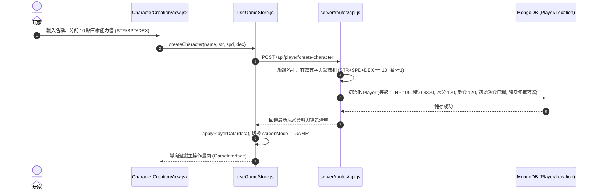

- **涉及檔案與函式**：
  - 前端視圖：`src/views/CharacterCreationView.jsx`
  - 前端狀態：`src/store/useGameStore.js` -> `createCharacter(name, str, spd, dex)`
  - 後端路由：`server/routes/api.js` -> `router.post('/player/create-character')`
  - 核心輔助：`server/utils/dbHelper.js` -> `generateInstanceId()`, `formatPlayerResponse()`
- **關鍵功能與運作機制**：
  1. **屬性點數驗證與定義**：
     - 嚴格驗證三維能力值（力量 `strength`、速度 `speed`、精巧 `dexterity`）每項皆為有效數字且 `>= 1`，總和必須精準等於 10 點。
     - **力量 (strength)**：影響物理攻擊力、採集類工作速度。
     - **速度 (speed)**：影響戰鬥的行動順序與閃避率、移動速度。
     - **精巧 (dexterity)**：影響戰鬥的命中率、製造類工作速度。
  2. **角色預設狀態**：生命值 `hp=100 / maxHp=100`、精力值 `energy=4320 / maxEnergy=4320`、水分 `water=120`、飽食度 `food=120`、金錢 `money=0`。
  3. **初始物品發放**：初始背包包含 10 份滿耐久的熟食口糧（具備獨立 `instanceId` 與 `lastDecayedAt` 時間戳）以及 1 個預先裝滿飲用水的隨身液體容器。
  4. **探索起點與初始地點**：預設出生起點為蔚藍灣市集（`AZURE_BAY_MARKET`），預設已知地點包含港口、市集、城門、石原、雜貨店、石壁、石壁洞穴與近海海域。

---

### 2. 移動至其他地圖 (Move to Another Map)

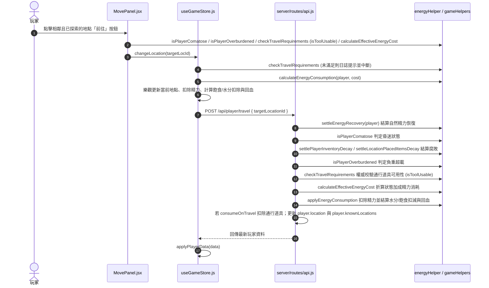

- **涉及檔案與函式**：
  - 前端視圖：`src/components/panels/MovePanel.jsx`
  - 前端狀態：`src/store/useGameStore.js` -> `changeLocation(targetLocId)`
  - 後端路由：`server/routes/api.js` -> `router.post('/player/travel')`
  - 核心輔助：`server/utils/energyHelper.js` 與 `src/utils/gameHelpers.js` -> `calculateEffectiveEnergyCost()`, `applyEnergyConsumption()`, `calculateEnergyConsumption()`, `isPlayerComatose()`, `isPlayerOverburdened()`, `checkTravelRequirements()`, `isToolUsable()`
- **關鍵功能與運作機制**：
  1. **通行資格檢驗**：
     - 目標地點必須與當前地點存在於場景定義的 `connections` 路徑連線中。
     - 目標地點必須存在於玩家的已知地點清單 `player.knownLocations` 中。
     - 若角色處於昏迷（水分、飽食或 HP `<= 0`）或負重超載（背包總重 `>` 負重上限），禁止移動。
     - **路徑特定道具檢驗**：若路徑定義了特定道具需求（`requiredItemId` 或 `requiredItemType`），玩家背包中必須具備相應道具且通過 `isToolUsable` 檢驗（可用耐久度 > 0 或為永久免損耗道具）。未滿足時前端標註需求徽章並禁用前往按鈕，後端同步進行 400 安全攔截；若定義了 `consumeOnTravel`，則於通行成功時扣除 1 份通行道具。
  2. **動態精力折算**：透過 `calculateEffectiveEnergyCost` 依玩家飽食/水分狀態（充沛飽足 -10%、飢渴虛弱 +20%）計算實際消耗精力。
  3. **生存數值累加扣減**：呼叫 `applyEnergyConsumption`，每累計消耗 15 點精力扣除 1 點水分與 1 點飽食度；若處於充沛飽足狀態，每累計消耗 10 點精力恢復 1 點 HP。
  4. **地點探索記錄**：若目標地點為首次造訪，自動加入玩家的 `knownLocations` 清單並儲存至資料庫。

---

### 3. 採集 (Gathering)

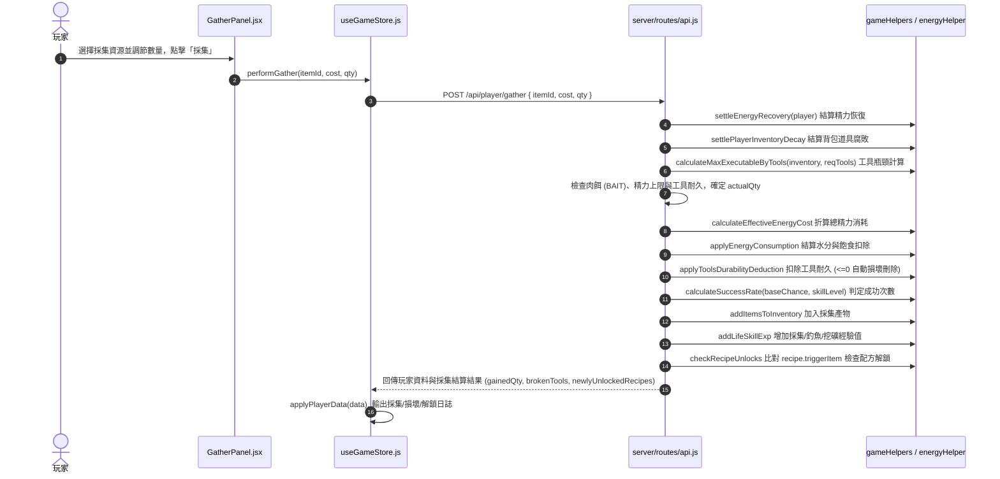

- **涉及檔案與函式**：
  - 前端視圖：`src/components/panels/GatherPanel.jsx`
  - 前端狀態：`src/store/useGameStore.js` -> `performGather(itemId, cost, qty)`
  - 後端路由：`server/routes/api.js` -> `router.post('/player/gather')`
  - 核心輔助：`src/utils/gameHelpers.js` -> `calculateMaxExecutableByTools()`, `applyToolsDurabilityDeduction()`, `calculateSuccessRate()`, `addLifeSkillExp()`, `addItemsToInventory()`, `checkRecipeUnlocks()`
- **關鍵功能與運作機制**：
  1. **多重瓶頸綜合裁定**：依據玩家當前精力、肉餌儲量（如釣魚需要 `BAIT`）以及背包中工具耐久度，計算單次最大允許執行的實際次數 `actualQty = min(addQty, maxByEnergy, maxByBait, maxByTools)`。
  2. **工具耐久扣除與損壞銷毀**：透過 `applyToolsDurabilityDeduction` 依耐久度升序選取的工具扣除耐久；耐久度扣至 `<= 0` 時自動自背包中移除，並於系統日誌中發布「[工具名稱]已損壞。」。
  3. **生活技能成功率加成**：調用 `calculateSuccessRate(baseChance, currentSkillLevel)`，生活技能每提升 1 級提供 +5% 成功率加成；每份採集產出皆逐一進行機率抽籤判定成功與失敗次數。
  4. **經驗累積與升級**：依產出數量與採集點設定之 `expPerUnit` 透過 `addLifeSkillExp` 累加對應生活技能經驗（採集 `GATHERING`、釣魚 `FISHING`、挖礦 `MINING`）。
  5. **採集觸發新配方解鎖**：若採集獲得新素材，呼叫 `checkRecipeUnlocks` 比對配方的 `triggerItem`，自動解鎖新配方並輸出提示日誌。

---

### 3-1. 採集水 (Gathering Water)

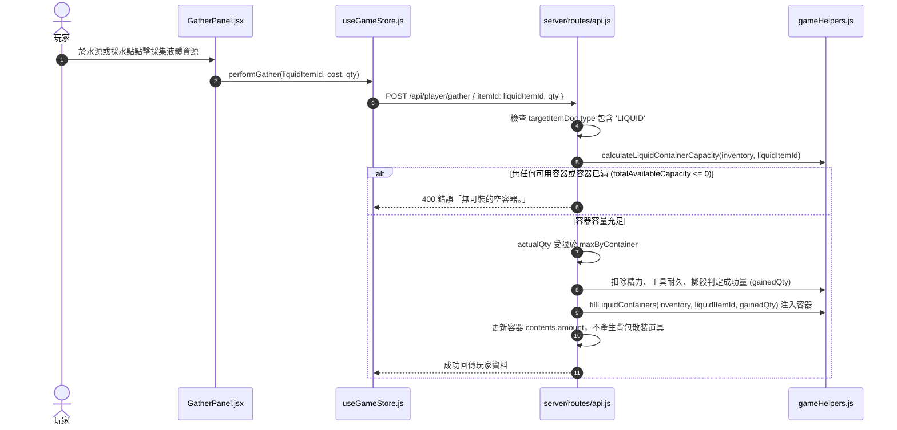

- **涉及檔案與函式**：
  - 前端視圖：`src/components/panels/GatherPanel.jsx`
  - 前端狀態：`src/store/useGameStore.js` -> `performGather(itemId, cost, qty)`
  - 後端路由：`server/routes/api.js` -> `router.post('/player/gather')`
  - 核心輔助：`src/utils/gameHelpers.js` -> `calculateLiquidContainerCapacity()`, `fillLiquidContainers()`
- **關鍵功能與運作機制**：
  1. **液體資源判定**：目標資源道具屬性包含 `type: 'LIQUID'`。液體不可作為獨立散裝道具直接放入背包。
  2. **容器檢索與可用容量計算**：調用 `calculateLiquidContainerCapacity`：
     - 檢查背包中所有類型為 `CONTAINER` 且 `allowedContent: 'LIQUID'` 的容器。
     - 單一容器遵循「一容器裝一種液體」規則：已裝其他液體的容器不可注入；僅空容器或已裝同種液體（存量 `<` 上限容量 `capacity`）的容器可承裝。
     - 計算剩餘可用總容量 `totalAvailableCapacity`。若為 0 則拒絕採集並回報「無可裝的空容器。」。
  3. **容器容量瓶頸限制**：採集實際次數額外受限於 `maxByContainer`；若採集請求數量大於容器總剩餘空間，系統輸出日誌「容器空間有限，只夠裝 X 份。」。
  4. **注入容器實體**：採集成功後調用 `fillLiquidContainers`，優先將採得的液體注入已盛裝同種液體的容器，其次填入空容器，累加其 `contents: { itemId, amount }`，容器本身實體識別碼與屬性保持不變。

---

### 4. 製作 (Crafting)

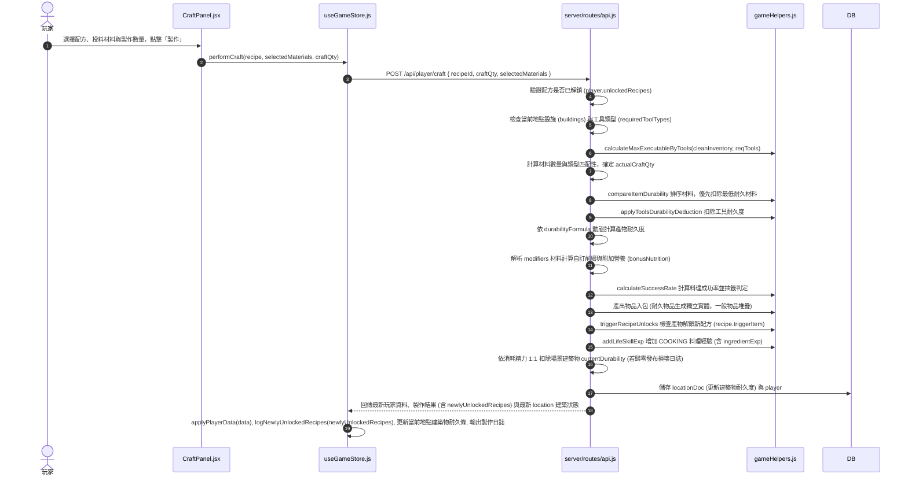

- **涉及檔案與函式**：
  - 前端視圖：`src/components/panels/CraftPanel.jsx`
  - 前端狀態：`src/store/useGameStore.js` -> `performCraft(recipe, selectedMaterials, craftQty)`, `logNewlyUnlockedRecipes()`
  - 後端路由：`server/routes/api.js` -> `router.post('/player/craft')`, `triggerRecipeUnlocks()`
  - 核心輔助：`shared/utils/gameHelpers.js` -> `calculateMaxExecutableByTools()`, `compareItemDurability()`, `applyToolsDurabilityDeduction()`, `calculateSuccessRate()`, `addLifeSkillExp()`, `addItemsToInventory()`, `checkRecipeUnlocks()`
- **關鍵功能與運作機制**：
  1. **配方權限與環境設施驗證**：檢查配方是否位於玩家 `player.unlockedRecipes` 中；檢查當前場景建築設施（如加熱設施 `HEATING`、烹飪設施 `COOKING`）或背包工具是否滿足 `requiredToolTypes`；背包工具透過 `isToolUsable` 判定可用性（相容消耗型耐久度工具與永久免損耗工具如平底鍋）。
  2. **原料損耗優選順序**：透過 `compareItemDurability` 優先消耗背包中耐久度最低（即最接近腐壞）的材料實體。
  3. **耐久度公式計算**：若配方定義了動態計算公式 `durabilityFormula`（例如由主材料的剩餘耐久折算產物耐久），以主消耗材料代入函式計算生成物的實際耐久度。
  4. **修飾詞與客製化前綴**：配方支援基底材料（base）與修飾材料（modifier）。當投入修飾素材時，依據 `recipe.modifiers` 自動生成客製化前綴（如 `[修飾前綴]・[產物名稱]`）與額外營養加成 `bonusNutrition`。
  5. **生活技能成功率與產出實體化**：依料理技能等級判定成功率；成功產物若具有耐久度，一律逐一指派全域唯一識別碼 `generateInstanceId()` 生成獨立實體，並記錄 `lastDecayedAt`。
  6. **生活技能經驗累積**：製作完成後依配方基礎經驗與投入材料加成經驗（`ingredientExp`），透過 `addLifeSkillExp` 累加烹飪經驗值。
  7. **建築物耐久度 1:1 消耗與後端阻擋**：
     - 若配方所需設施由場景中具備有限耐久度的建築物（`durability !== -1`）提供，後端嚴格驗證其 `currentDurability > 0`；若耐久度歸零則前後端同步阻擋。
     - 製作成功後，依據 `totalEnergyCost` 實際消耗精力，以 **1:1** 扣除該地點建築物的 `currentDurability`（最低至 0）。
     - 若耐久度耗盡降至 0，發布系統日誌「場景設施【建築物名稱】已耗盡耐久度並損壞！」，並隨 API 回傳最新場景資料，前端建築物耐久度進度條即時更新。
  8. **製作產物觸發新配方解鎖**：若製作成功（`successCraftQty > 0`）獲得新產物，透過 `triggerRecipeUnlocks` 比對所有配方的 `triggerItem`。若符合且尚未擁有，自動加入玩家的 `unlockedRecipes`，並隨 API 回傳 `newlyUnlockedRecipes`，前端透過 `logNewlyUnlockedRecipes` 輸出提示日誌「這好像可以做成[配方名稱]。」。

---

### 4-1. 修復建築物 (Building Repair)

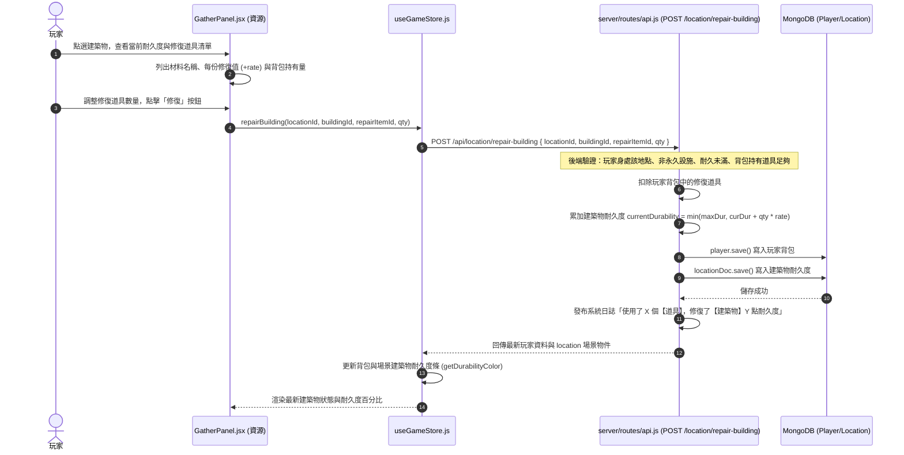

- **涉及檔案與函式**：
  - 前端視圖：`src/components/panels/GatherPanel.jsx`
  - 前端狀態：`src/store/useGameStore.js` -> `repairBuilding(locationId, buildingId, repairItemId, qty)`
  - 後端路由：`server/routes/api.js` -> `router.post('/location/repair-building')`
  - 資料模型：`server/models/Building.js` (`durability`, `repairItems`) 與 `server/models/Location.js` (`currentDurability`)
- **關鍵功能與運作機制**：
  1. **SSOT 耐久度架構**：建築物基礎最大耐久度由 `Building.durability` 維護，場景實例僅記錄 `currentDurability`，杜絕冗餘記錄。
  2. **修復材料需求清單**：詳情視窗清晰列出該建築物支援的修復材料名稱、圖示、每份修復值 (`rate`) 與背包目前持有量，未持有時給予明確提示。
  3. **防浪費數量選擇**：數量選擇器上限取「背包持有量」與「修復至滿額所需量」之最小值，避免過度消耗素材。
  4. **色彩狀態回饋**：耐久度條統一套用 `getDurabilityColor`（>90% 綠色、31-90% 黃色、<=30% 紅色），耐久度歸零標示已損壞。

---

### 5. 購買 (Purchasing)

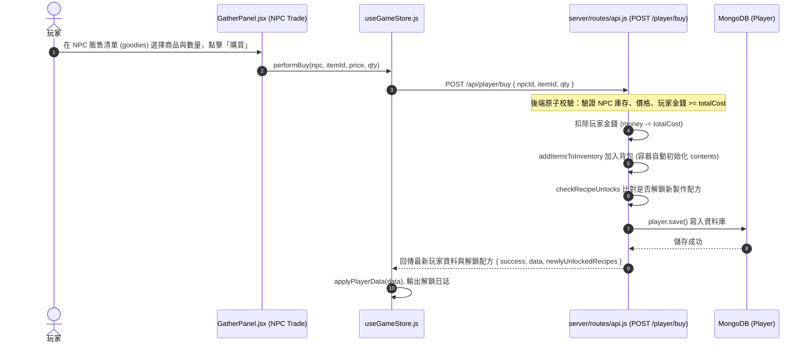

- **涉及檔案與函式**：
  - 前端視圖：`src/components/panels/GatherPanel.jsx` (NPC 交易彈窗)
  - 前端狀態：`src/store/useGameStore.js` -> `performBuy(npc, itemId, price, qty)`
  - 後端路由：`server/routes/api.js` -> `router.post('/player/buy')`
  - 核心輔助：`shared/utils/gameHelpers.js` -> `addItemsToInventory()`, `checkRecipeUnlocks()`
- **關鍵功能與運作機制**：
  1. **後端原子性扣款與驗證**：計算總花費 `totalCost = unitPrice * buyQty`，由後端直接檢驗玩家資料庫金錢 `player.money >= totalCost`，不足時拒絕交易，徹底防止用戶端竄改金額。
  2. **容器道具自動初始化**：若購入物品為容器（包含 `CONTAINER` 類型或定義有 `capacity` 容量），後端自動為其附加容器結構 `contents: { itemId: '', amount: 0 }`。
  3. **購物觸發配方解鎖**：調用 `checkRecipeUnlocks`，若購買的道具為特定配方的前置解鎖道具（`recipe.triggerItem`），自動將該配方加入 `unlockedRecipes`，並於回應附帶 `newlyUnlockedRecipes` 供前端發送「這好像可以做成...」的提示訊息。
  4. **後端直接持久化**：後端直接執行 `player.save()` 更新資料庫並回傳最新玩家資料物件，前端僅呼叫 `applyPlayerData` 渲染。

---

### 6. 出售 (Selling)

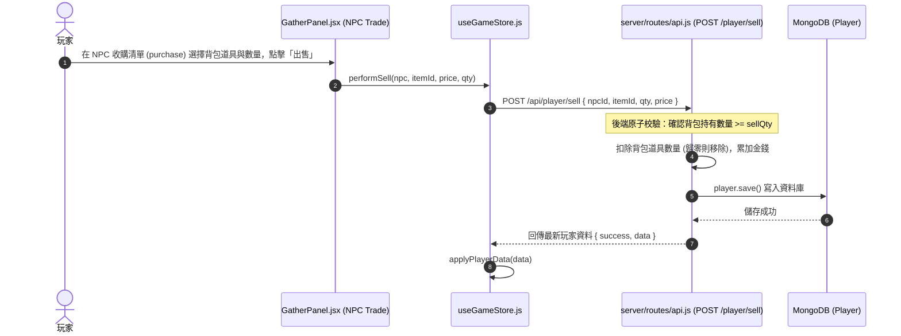

- **涉及檔案與函式**：
  - 前端視圖：`src/components/panels/GatherPanel.jsx` (NPC 交易彈窗)
  - 前端狀態：`src/store/useGameStore.js` -> `performSell(npc, itemId, price, qty)`
  - 後端路由：`server/routes/api.js` -> `router.post('/player/sell')`
- **關鍵功能與運作機制**：
  1. **後端庫存持有檢驗**：由後端在資料庫背包陣列中檢索該道具實體，確認目前持有總數 `currentOwned >= sellQty`，防止前端憑空出售不存在的物品。
  2. **庫存扣除與清除**：若出售數量等於當前持有量，自背包陣列中移除該物品項目；若出售部分數量，更新該道具的 `count` 欄位。
  3. **金錢收入結算**：依 NPC 收購清單單價計算收益 `totalGain = unitPrice * sellQty`，累加至玩家持有金錢 `player.money`。
  4. **資料庫直接原子寫入**：後端結算完畢後立即 `await player.save()` 寫入資料庫，並將最新數據回傳前端。

---

### 7. 食用食物 (Eating Food)

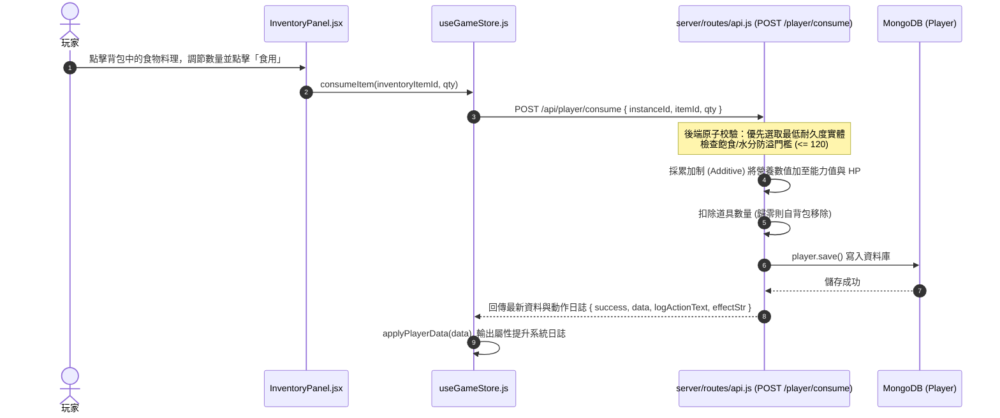

- **涉及檔案與函式**：
  - 前端視圖：`src/components/panels/InventoryPanel.jsx`
  - 前端狀態：`src/store/useGameStore.js` -> `consumeItem(inventoryItemId, qty)`
  - 後端路由：`server/routes/api.js` -> `router.post('/player/consume')`
  - 核心輔助：`shared/utils/gameHelpers.js` -> `compareItemDurability()`, `settleItemDecay()`
- **關鍵功能與運作機制**：
  1. **後端低耐久優先消耗**：當玩家持有多份同類食品時，後端透過 `compareItemDurability` 排序，優先吃掉耐久度最低、最接近過期的食物實體。
  2. **防溢防浪費驗證**：若食用該食物所帶來的飽食度或水分增加量會導致玩家當前數值超過上限 120 (`MAX_FOOD` / `MAX_WATER`)，後端自動拒絕操作並回傳提示「現在還不需要這個。」。
  3. **營養數值累加機制 (Additive)**：食物所含的各項營養數值（包含道具基礎 `nutrition` 與客製化料理附加的 `bonusNutrition`）直接以加法累加至玩家的各項基礎能力值（力量、速度、精巧、防禦、最大生命、當前生命、水分、飽食度），非覆寫。
  4. **日誌與原子持久化**：後端計算變動文字並直接 `player.save()` 寫入資料庫，前端接收回傳資料更新狀態並印出系統事件日誌。

---

### 7-1. 飲用飲料 (Drinking Beverage)

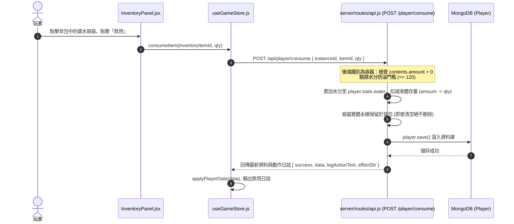

- **涉及檔案與函式**：
  - 前端視圖：`src/components/panels/InventoryPanel.jsx`
  - 前端狀態：`src/store/useGameStore.js` -> `consumeItem(inventoryItemId, qty)`
  - 後端路由：`server/routes/api.js` -> `router.post('/player/consume')`
- **關鍵功能與運作機制**：
  1. **容器與液體解構識別**：後端檢測到道具類型包含 `CONTAINER` 時，切換至容器飲用邏輯分支。
  2. **內裝液體存量檢驗**：檢查容器內的 `contents: { itemId, amount }`。若存量 `<= 0` 或 `itemId` 為空，拒絕操作並提示「[...] 裡沒有任何液體，無法飲用。」。
  3. **水分上限防溢控制**：讀取內裝液體的營養數據，若飲用後水分將超過上限 120，阻止操作並提示「現在還不需要這個。」。
  4. **容器本體永續保留**：飲用僅扣除容器內部的液體存量 `contents.amount`（若全部喝完則將 `contents.itemId` 設為空字串），**容器實體本身完整保留於背包中**，絕不被刪除。
  5. **原子儲存與日誌同步**：增加的水分累加至 `player.stats.water`，後端保存至 DB 並回傳日誌文字，前端呼叫 `applyPlayerData` 刷新介面。

---

### 8. 恢復精力 (Restoring Energy)

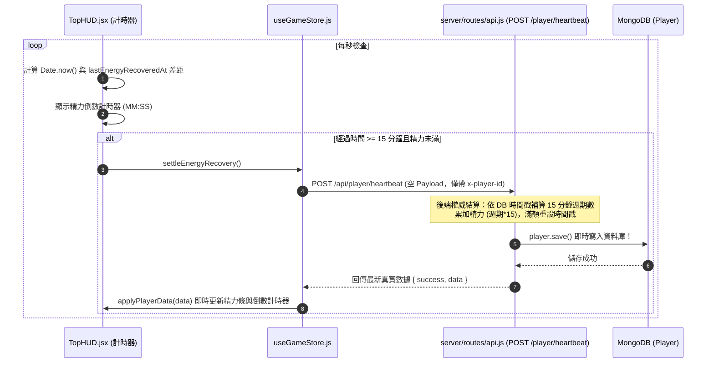

- **涉及檔案與函式**：
  - 前端定時器：`src/components/TopHUD.jsx` (`useEffect` 週期定時器)
  - 前端狀態：`src/store/useGameStore.js` -> `settleEnergyRecovery()`, `triggerHeartbeat()`
  - 後端路由：`server/routes/api.js` -> `router.post('/player/heartbeat')`
  - 後端輔助：`shared/utils/energyHelper.js` -> `settleEnergyRecovery(player)`
  - 核心常數：`shared/constants/gameConstants.js` (`ENERGY_RECOVERY_INTERVAL_MS=900000`, `ENERGY_RECOVERY_AMOUNT=15`, `MAX_ENERGY=4320`)
- **關鍵功能與運作機制**：
  1. **核心恢復規則**：基準間隔為 15 分鐘（900,000 毫秒），每滿一個週期自然恢復 15 點精力，最大上限為 4320 點。
  2. **前端即時倒數與心跳觸發**：`TopHUD` 每秒更新剩餘倒數秒數；當間隔期滿時呼叫 `settleEnergyRecovery()`，發送 `POST /api/player/heartbeat` 心跳至後端，前端不預先自算覆寫。
  3. **後端權威計算與即時寫入 DB**：後端接收心跳後，依據資料庫中記錄的真實時間戳補足離線週期數，累加精力並直接調用 `player.save()` 寫入資料庫，隨後回傳格式化後的真實數據，前端收到後立即渲染最新數值，保證資料庫與畫面 100% 同步。
  4. **滿精力防溢基準錨定**：若精力已達上限 4320，基準時間戳自動校正錨定為當前時間，防止滿精力期間繼續暗中累計週期。

---

### 9. 丟棄道具 (Discarding Item)

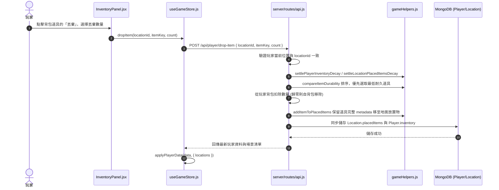

- **涉及檔案與函式**：
  - 前端視圖：`src/components/panels/InventoryPanel.jsx`
  - 前端狀態：`src/store/useGameStore.js` -> `dropItem(locationId, itemKey, count)`
  - 後端路由：`server/routes/api.js` -> `router.post('/player/drop-item')`
  - 核心輔助：`src/utils/gameHelpers.js` -> `compareItemDurability()`, `addItemToPlacedItems()`
- **關鍵功能與運作機制**：
  1. **位置防偽檢驗**：後端嚴格驗證玩家當前所在場景 `player.location` 必須與請求丟棄的地點 `locationId` 完全一致。
  2. **優先丟棄低耐久道具**：透過 `compareItemDurability` 排序，優先扣減耐久度最低的實體道具。
  3. **完整實體屬性封裝**：被丟棄的道具實體完整保留所有 metadata（包括 `instanceId`、當前與最大耐久度 `durability`/`maxDurability`、品質 `quality`、自訂修飾名稱 `customName`/`customNameEn`、料理附加營養 `bonusNutrition`、水壺容器內裝內容物 `contents` 以及腐敗基準時間戳 `lastDecayedAt`）。
  4. **現場地面物品堆疊或獨立生成**：呼叫 `addItemToPlacedItems`：有耐久度的道具在地面維持獨立實體；無耐久度的道具則自動與地面同類道具堆疊計數。

---

### 10. 撿起道具 (Picking Up Item)

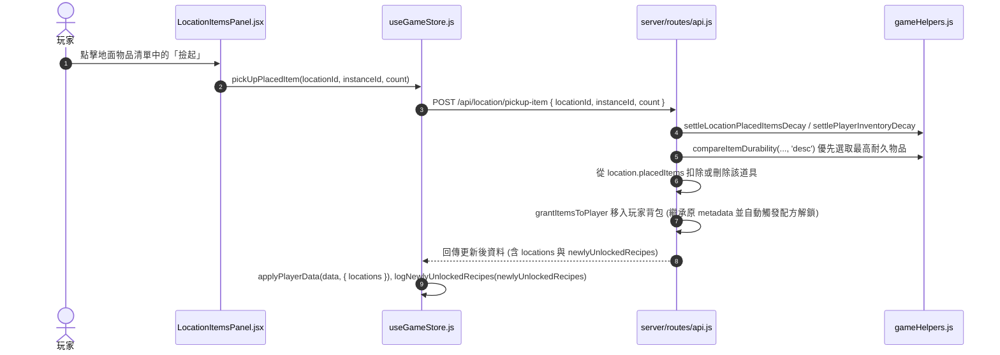

- **涉及檔案與函式**：
  - 前端視圖：`src/components/panels/LocationItemsPanel.jsx`
  - 前端狀態：`src/store/useGameStore.js` -> `pickUpPlacedItem(locationId, instanceId, count)`, `logNewlyUnlockedRecipes()`
  - 後端路由：`server/routes/api.js` -> `router.post('/location/pickup-item')`, `grantItemsToPlayer()`
  - 核心輔助：`shared/utils/gameHelpers.js` -> `compareItemDurability()`, `addItemsToInventory()`, `checkRecipeUnlocks()`
- **關鍵功能與運作機制**：
  1. **優選高品質與高耐久道具**：當地面存在多件同類物品時，後端排序優先挑選耐久度最高（`compareItemDurability(a, b, 'desc')`）的物品供玩家拾起。
  2. **現場物品轉移與背包堆疊**：從場景 `location.placedItems` 陣列中扣減或刪除該物品，透過 `grantItemsToPlayer` 統一將其轉移入玩家背包 `player.inventory`，繼承所有原始 metadata（當前耐久度、品質、容器內容物等）。
  3. **拾取觸發配方解鎖**：透過 `grantItemsToPlayer` 統一發放道具，拾取入包時自動比對 `recipe.triggerItem`，若吻合即時解鎖新配方，並由前端輸出「這好像可以做成[配方名稱]。」提示日誌。

---

### 11. 道具腐壞 (Item Decay)

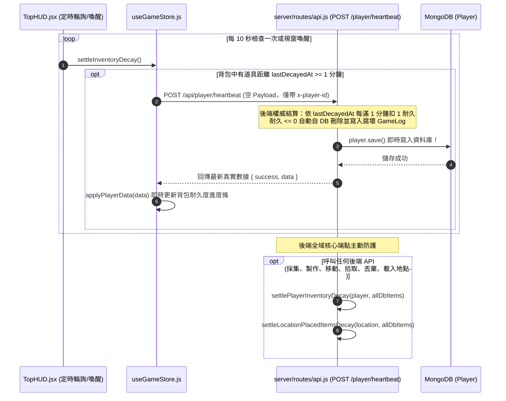

- **涉及檔案與函式**：
  - 前端定時器：`src/components/TopHUD.jsx` (`useEffect` 每 10 秒檢查與視窗喚醒監聽)
  - 前端狀態：`src/store/useGameStore.js` -> `settleInventoryDecay()`, `triggerHeartbeat()`
  - 後端路由：`server/routes/api.js` -> `router.post('/player/heartbeat')`
  - 後端函式：`server/routes/api.js` -> `settlePlayerInventoryDecay()`, `settleLocationPlacedItemsDecay()`
  - 核心輔助：`shared/utils/gameHelpers.js` -> `isDecayItem()`, `settleItemDecay()`
- **關鍵功能與運作機制**：
  1. **易腐道具辨識**：`isDecayItem` 檢查道具的定義類型是否包含 `DECAY` 且具備有效耐久度（如生鮮魚肉、料理菜餚等）。
  2. **分鐘級時間戳遞減計算**：
     - 以道具內部獨立的時間戳 `lastDecayedAt` 為基準，比對當前時間經過的分鐘數：`elapsedMinutes = Math.floor(elapsedMs / 60000)`。
     - **每經過 1 分鐘扣除 1 點耐久度**，未滿 1 分鐘的零頭毫秒數精確保留於時間戳中 (`lastTime + elapsedMinutes * 60000`)。
  3. **過期自動銷毀與分級通知**：
     - 耐久度扣至 `<= 0` 的道具自動自陣列中銷毀剔除。
     - 若為**玩家背包道具**（`isPlayer: true`），後端自動在資料庫中記錄 GameLog「[道具名稱]已腐敗。」（英文：`[ItemName] has rotted.`），並即時儲存至 MongoDB。
     - 若為**地面放置道具**（`isPlayer: false`），過期自動靜默移除，不發送通知訊息。
  4. **後端權威心跳防護**：前端透過心跳觸發後端計算，徹底杜絕舊版前端傳送完整陣列覆寫所造成的併發道具遺失風險。

---

### 12. 解鎖配方 (Unlocking Recipes)

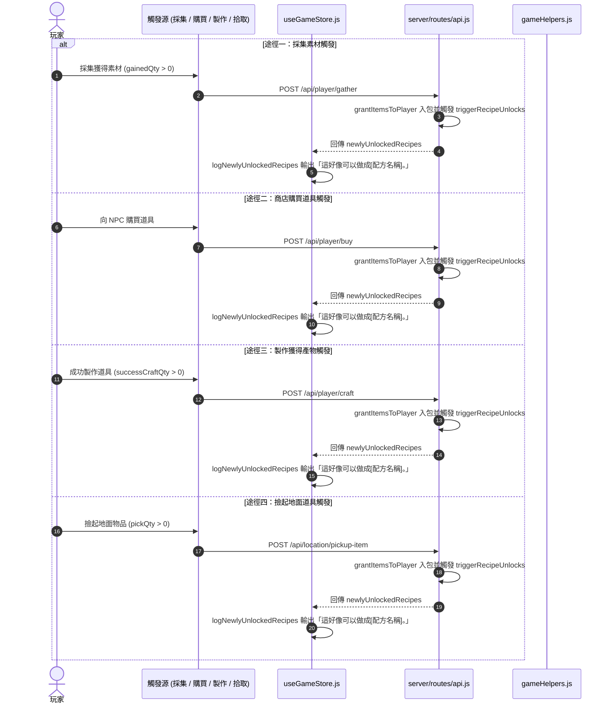

- **涉及檔案與函式**：
  - 前端狀態：`src/store/useGameStore.js` -> `performGather()`, `performBuy()`, `performCraft()`, `pickUpPlacedItem()`, `logNewlyUnlockedRecipes()`
  - 後端路由：`server/routes/api.js` -> `POST /api/player/gather`, `POST /api/player/buy`, `POST /api/player/craft`, `POST /api/location/pickup-item`, `grantItemsToPlayer()`, `triggerRecipeUnlocks()`
  - 核心輔助：`shared/utils/gameHelpers.js` -> `addItemsToInventory()`, `checkRecipeUnlocks()`
  - 前端視圖：`src/components/panels/CraftPanel.jsx` (製作權限過濾)
- **關鍵功能與運作機制**：
  1. **主要配方解鎖途徑（統一發放單一入口 grantItemsToPlayer）**：
     - **後端專用單一入口 `grantItemsToPlayer(player, itemsToAdd, allDbItems)`**：
       - **無耐久全新品（採集/購買）**：外部無需傳入 `options.durability`，函式自動自 `allDbItems` 取出資料庫預設設定處理堆疊或基礎耐久。
       - **具動態/繼承狀態（製作/拾取）**：優先採用傳入的 `options`（如製作動態耐久、自訂料理前綴、拾取地面殘餘耐久度等）。
       - **自動解鎖比對**：所有入包道具自動提取 ID 呼叫 `triggerRecipeUnlocks`，透過 `checkRecipeUnlocks` 比對 `recipe.triggerItem`。若符合且尚未擁有，自動更新 `player.unlockedRecipes` 並標記修改。
     - **前端專用函式 `logNewlyUnlockedRecipes(newlyUnlockedRecipes)`**：統一遍歷新解鎖配方清單，發布「這好像可以做成[配方名稱]。」系統事件日誌。
     - **四大觸發途徑**：
       - **採集獲得觸發**：在 `POST /player/gather` 獲得產物時觸發解鎖判定。
       - **商店購買觸發**：在 `POST /player/buy` 購買道具入包時觸發解鎖判定。
       - **製作獲得產物觸發**：在 `POST /player/craft` 成功製作產出道具時觸發解鎖判定（支援多產出道具批次比對）。
       - **拾取地面道具觸發**：在 `POST /location/pickup-item` 撿起地面物品入包時觸發解鎖判定。
  2. **製作權限守門機制**：在 `CraftPanel` 面板僅顯示與允許點擊已解鎖的配方；後端 `POST /player/craft` 端點亦會前置驗證 `player.unlockedRecipes`，未解鎖的配方一律回傳 400 錯誤。

---

### 13. 飽食度增減益計算 (Satiety Buff & Debuff Calculation)

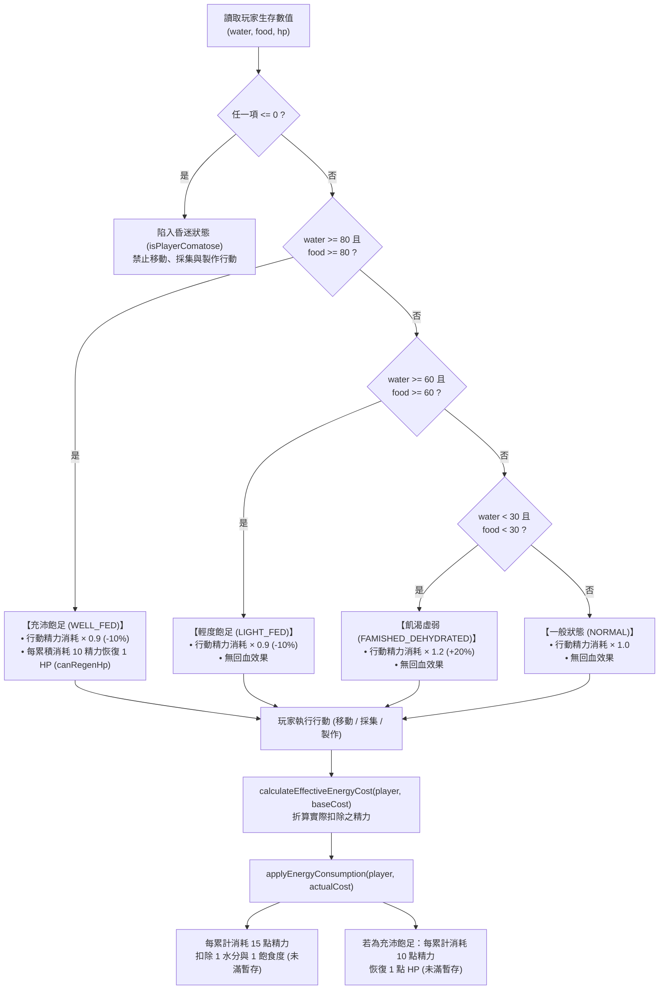

- **涉及檔案與函式**：
  - 核心常數（前後端 SSOT）：`src/constants/gameConstants.js`
  - 前後端通用演算法：`server/utils/energyHelper.js` 與 `src/utils/gameHelpers.js` -> `getStatusEffects()`, `calculateEffectiveEnergyCost()`, `applyEnergyConsumption()`, `isPlayerComatose()`
  - 前端狀態運算：`src/store/useGameStore.js` -> `calculateEnergyConsumption()`
  - 前端介面呈現：`src/components/TopHUD.jsx` (頂部狀態徽章與 Tooltip 懸浮說明)
- **關鍵功能與運作機制**：
  1. **全域數值常數定義 (SSOT)**：
     - 水分上限 `MAX_WATER = 120`，飽食度上限 `MAX_FOOD = 120`。
     - 固定數值判定門檻：`80` (充沛飽足)、`60` (輕度飽足)、`30` (飢渴虛弱)。
     - 週期常數：每消耗 15 點精力扣 1 水分飽食 (`ENERGY_DRAIN_CYCLE = 15`)；充沛飽足下每消耗 10 點精力回 1 HP (`ENERGY_HP_REGEN_CYCLE = 10`)。
  2. **四大狀態效果判定 (`getStatusEffects`)**：
     - **充沛飽足 (WELL_FED)**：飽食度 `>= 80` 且 水分 `>= 80`。行動精力消耗 -10%（`multiplier = 0.9`），並具備回血能力（`canRegenHp = true`）。
     - **輕度飽足 (LIGHT_FED)**：飽食度 `>= 60` 且 水分 `>= 60`（且未達充沛飽足）。行動精力消耗 -10%（`multiplier = 0.9`），不具備回血能力。
     - **飢渴虛弱 (FAMISHED_DEHYDRATED)**：飽食度 `< 30` 且 水分 `< 30`（兩項皆低於 30）。行動精力消耗 +20%（`multiplier = 1.2`）。
     - **一般狀態 (NORMAL)**：其餘數值區間，行動精力消耗維持 1.0 倍率。
  3. **行動精力折算與能力速度加成 (calculateEffectiveEnergyCost)**:
     - 所有消耗精力的行動（地點移動、資源採集、物品製作）皆透過此函式整合**飽食度狀態倍率**與**三維能力值加成**。
     - 依傳入之行動類型（TRAVEL、GATHER、CRAFT）對應至速度（speed）、力量（strength）或精巧（dexterity）。
     - 依方案 B 公式 Math.max(0.5, 1 - (stat - 1) * 0.01) 計算能力折扣（每點 -1%，最多 -50%），並與飽食度倍率相乘（精確至小數點後三位），在介面上即時給予玩家精準的動態折扣綠字（如 (-19%)）或增耗紅字。
  4. **生存數值衰減與飽足回血累加器**：
     - 調用 `applyEnergyConsumption` / `calculateEnergyConsumption`。
     - **水分與飽食扣除**：將當前精力消耗累加至 `player.energySpentAccumulator`，每滿 15 點扣除 1 水分與 1 飽食度，餘數保留至下次行動。
     - **飽足生命回復**：處於充沛飽足時，精力消耗累加至 `player.hpRegenAccumulator`，每滿 10 點恢復 1 點 HP（不超過 `maxHp`），餘數保留至下次行動。
  5. **昏迷判定與行動封鎖 (`isPlayerComatose`)**：當水分、飽食度或生命值任一項小於等於 0 時，判定玩家處於昏迷狀態。此時面板禁用移動、採集與製作按鈕，並於日誌發布「【角色名稱】處於昏迷中，無法行動！」。

---

## 🚀 4. 本地開發與啟動指南 (Setup & Getting Started)

### 1. 安裝相依套件
```bash
npm install
```

### 2. 環境變數設定 (`.env`)
在專案根目錄確認或建立 `.env` 檔案：
```env
PORT=5000
MONGODB_URI=mongodb+srv://<username>:<password>@cluster.mongodb.net/AetherImmersion?retryWrites=true&w=majority
VITE_GOOGLE_CLIENT_ID=your_google_client_id.apps.googleusercontent.com
GOOGLE_CLIENT_ID=your_google_client_id.apps.googleusercontent.com
```
*(若未設定 Google Client ID，系統將自動啟動 Demo 模擬登入模式供開發測試)*

### 3. 啟動後端 Express API 伺服器
```bash
node server/index.js
```
- API 服務網址：`http://localhost:5000`
- 健康檢查端點：`http://localhost:5000/api/health`

### 4. 啟動前端 Vite 開發伺服器
```bash
npm run dev
```
- 前端網頁介面：`http://localhost:5173`

### 5. 語法檢查與生產環境打包測試
```bash
# 執行 ESLint 程式碼檢查
npm run lint

# 執行 Vite 生產打包構建
npm run build
```

---

## ☁️ 5. 雲端正式環境部署指南 (Render 全端一體化託管)

本專案支援將前後端整合於單一 Node.js Web Service 部署於 [Render](https://render.com/)，具備企業級 SOC 2 資安防護、零跨網域 (CORS) 問題與全自動 HTTPS 憑證。

### 1. Render Web Service 設定參數
- **Environment**: `Node`
- **Region**: 建議選擇 `Singapore` 或 `Oregon`（離台灣與亞洲延遲較低）
- **Branch**: `main`
- **Build Command**: `npm install && npm run build`
- **Start Command**: `npm start`
- **Plan**: `Free`（或 Starter）

### 2. Render 環境變數 (Environment Variables)
在 Render 控制台的「Environment」分頁中新增以下密鑰：
| 變數名稱 | 說明 / 範例值 |
| :--- | :--- |
| `NODE_ENV` | `production` |
| `MONGODB_URI` | 遠端 MongoDB Atlas 完整連線字串 (`mongodb+srv://...`) |
| `GOOGLE_CLIENT_ID` | Google OAuth Client ID |
| `VITE_GOOGLE_CLIENT_ID` | 同上（供前端 Vite 編譯注入） |

### 3. Google OAuth 授權網域白名單
1. 部署完成後，取得 Render 分配之網址（例如 `https://aether-immersion.onrender.com`）。
2. 前往 [Google Cloud Console](https://console.cloud.google.com/apis/credentials) 編輯 OAuth 2.0 用戶端 ID。
3. 在「**已授權的 JavaScript 來源 (Authorized JavaScript origins)**」新增上述 Render 網址。
4. 儲存後數分鐘即可直接邀請玩家點擊網址進行遊玩！
